# Retail Sales Analysis

## Project Overview
This project focuses on analyzing retail sales data to identify sales trends, customer purchasing behavior, product performance, and profitability patterns.

The analysis aims to extract meaningful insights and provide data-driven business recommendations.

## Dataset
The dataset contains 12,000 retail transactions covering the period from January 2024 to December 2025.

It includes information about:
- Customer demographics
- Products and product categories
- Order dates and sales amounts
- Sales channels and payment methods
- Discounts, shipping costs, and delivery information
- Profit and customer ratings

## Tools & Technologies
- Python
- Pandas
- NumPy
- Matplotlib
- Seaborn
- Plotly
- Streamlit
- Jupyter Notebook

## Project Structure
```text
Task1_Retail_Sales_EDA/
│
├── data/
│   └── retail_sales_dataset.csv
│
├── notebooks/
│   └── Retail_Sales_Analysis.ipynb
│
├── outputs/
│   ├── monthly_sales_trend.png
│   ├── quarterly_sales_trend.png
│   ├── customer_age_groups.png
│   ├── orders_by_gender.png
│   ├── top_10_products.png
│   ├── revenue_by_category.png
│   ├── correlation_heatmap.png
│   ├── profit_by_order_channel.png
│   └── average_profit_by_channel.png
│
└── README.md
```

## Analysis Performed
- Data loading and inspection
- Data cleaning and handling missing values
- Exploratory Data Analysis (EDA)
- Descriptive statistics
- Monthly, quarterly, and yearly sales analysis
- Customer demographic analysis
- Product and category performance analysis
- Sales channel analysis
- Correlation analysis
- Profit margin analysis
- Business recommendations

## Key Findings
- Total sales increased by 18.13% in 2025 compared to 2024.
- Customers aged 26–35 generated the highest number of orders.
- Wireless Earbuds recorded the highest sales quantity among the top 10 products.
- Electronics generated the highest revenue, contributing 45.37% of total sales.
- The Mobile App recorded the highest order volume and total profit.
- Beauty achieved the highest profit margin at 50.79%.

## Business Recommendations
1. Review Electronics supplier costs, pricing, and discount strategies to improve profitability.
2. Invest in high-margin categories such as Beauty and Clothing.
3. Improve the Mobile App user experience and targeted marketing to support customer engagement and growth.

## How to Run
1. Clone or download the repository.
2. Install the required libraries.
3. Open the Jupyter Notebook:
   `notebooks/Retail_Sales_Analysis.ipynb`
4. Run the notebook cells to reproduce the analysis.

## Dashboard
An interactive Streamlit dashboard is available in the main project repository under the `dashboard` folder.

Run it from the repository root using:

```bash
streamlit run dashboard/app.py
```


## Interactive Dashboard

An interactive dashboard was developed using Streamlit to explore retail sales data and present key business insights.

### Dashboard Features
- Sales performance overview and KPIs.
- Monthly and quarterly sales trends.
- Customer demographics analysis.
- Product and category performance.
- Profitability analysis by category and sales channel.
- Interactive filters for year, region, and product category.


### Dashboard Screenshots

#### Overview
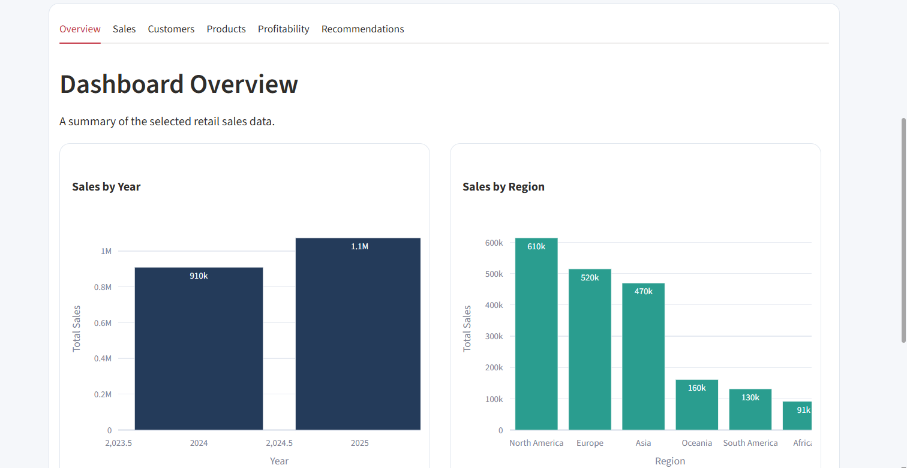
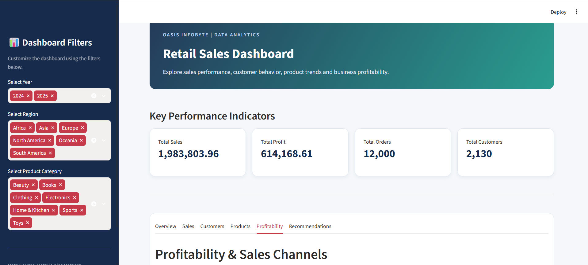

#### Sales Analysis
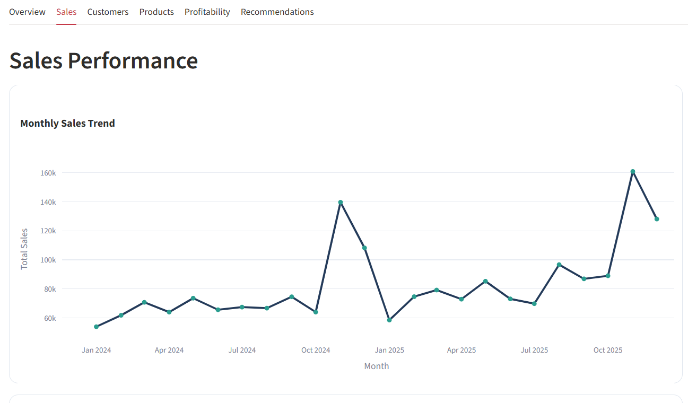
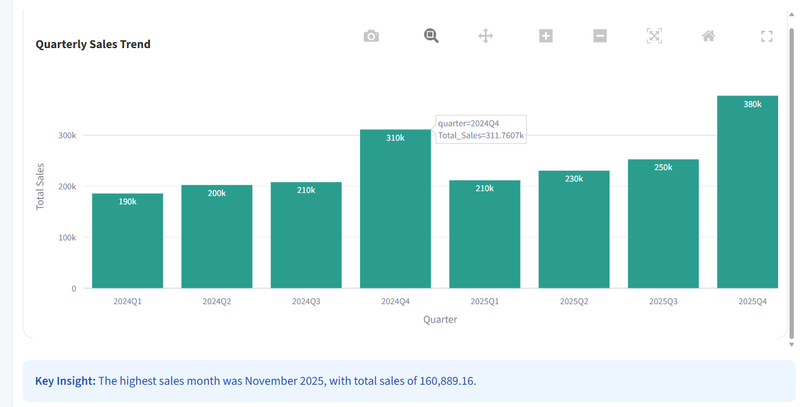

#### Customer Analysis
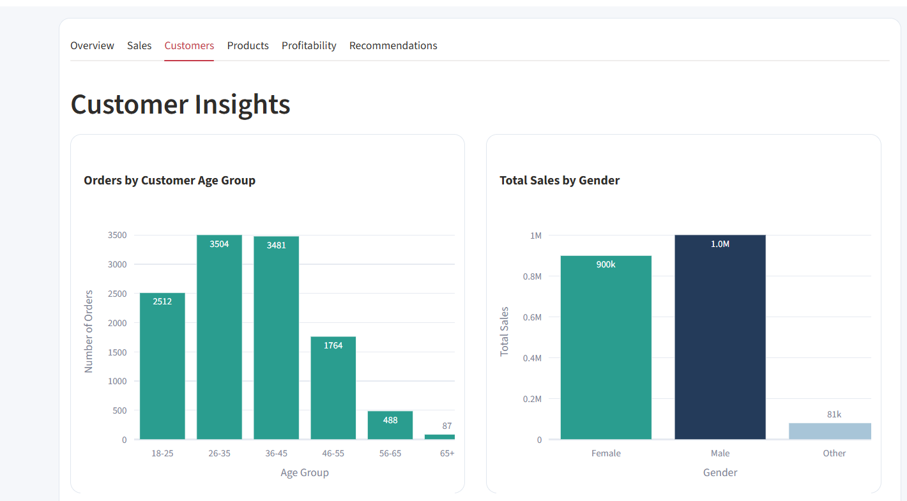
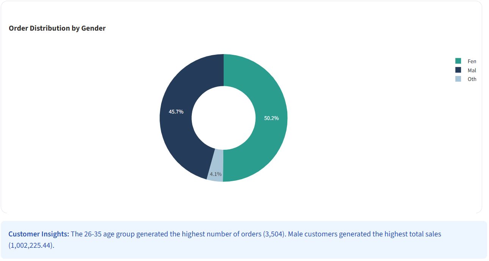

#### Products Analysis
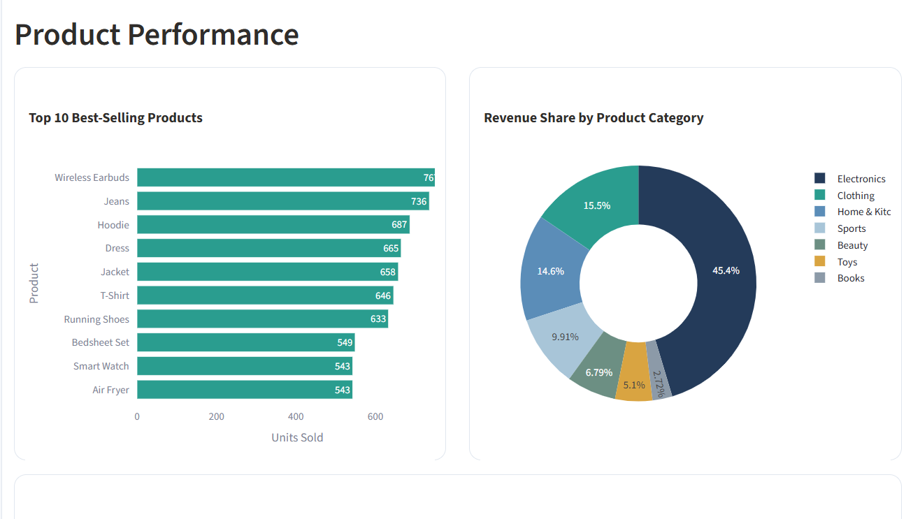
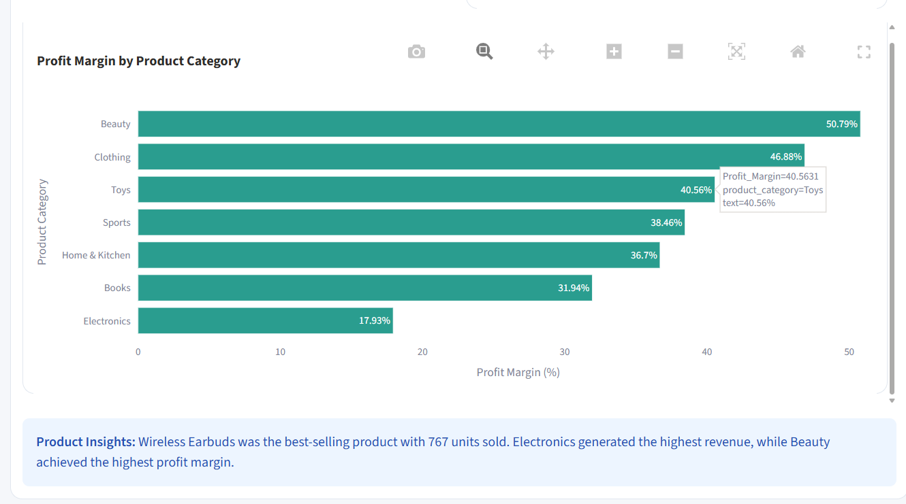

#### Profitability Analysis
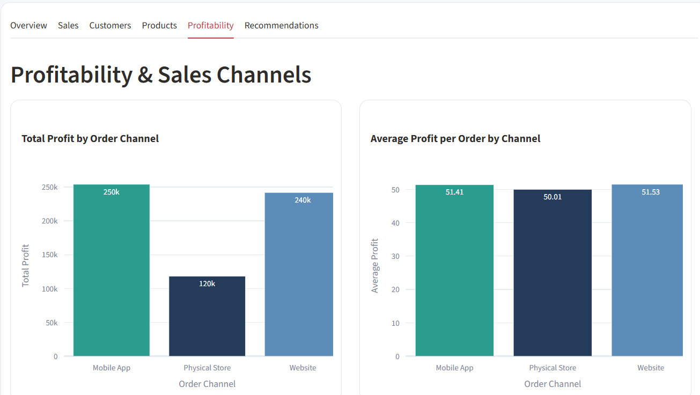
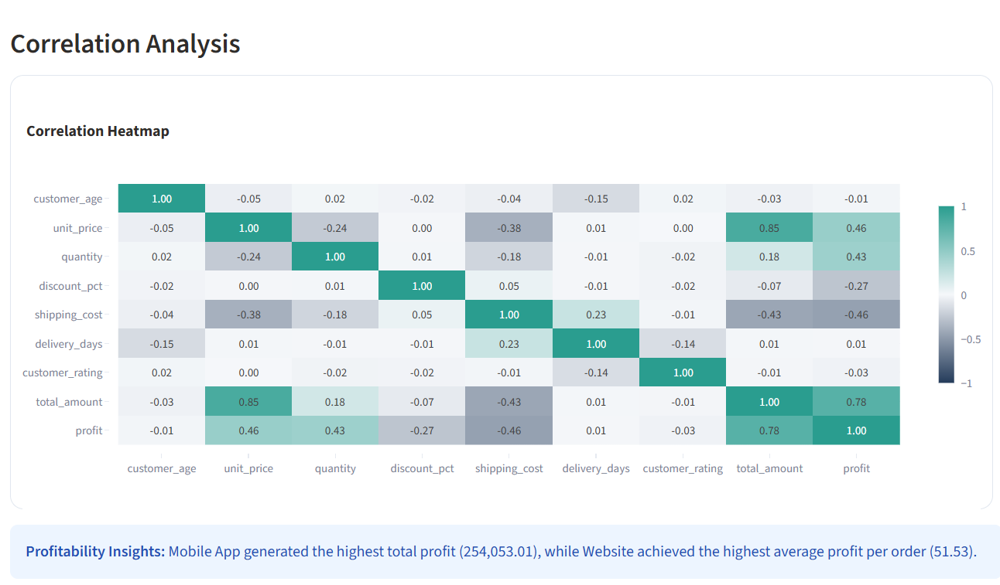

#### Business Recommendations
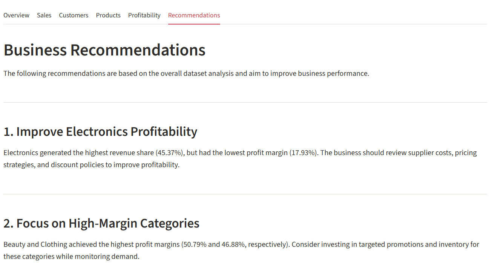
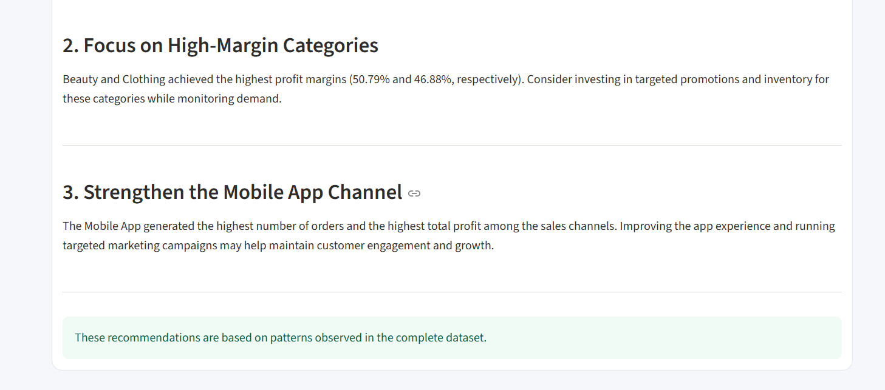

### How to Run the Dashboard

Install the required libraries:

```bash
pip install -r requirements.txt
```

Run the dashboard from the project folder:

```bash
streamlit run dashboard/app.py
```

