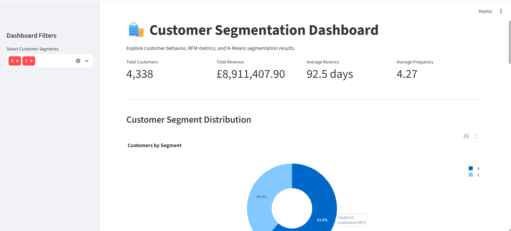
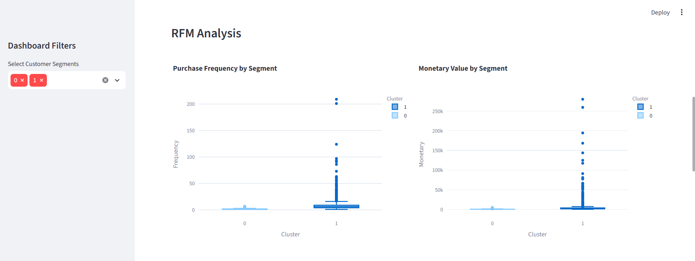
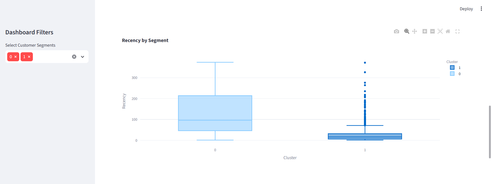
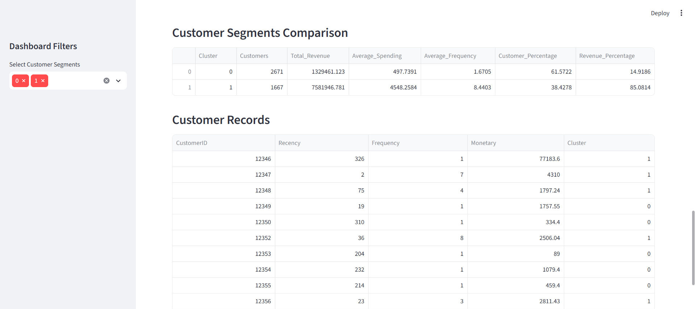

# Task 2: Customer Segmentation

## Project Overview

This project applies customer segmentation using **RFM (Recency, Frequency, Monetary) analysis** and **K-Means clustering** to identify customer groups based on purchasing behavior.

An interactive dashboard was also developed using **Streamlit** to explore customer segments, purchasing patterns, and business insights.

## Dataset

- **Source:** [UCI Machine Learning Repository – Online Retail](https://archive.ics.uci.edu/dataset/352/online-retail)
- **Original Records:** 541,909 transactions
- **Cleaned Records:** 397,884 transactions
- **Unique Customers:** 4,338

The dataset contains transactions from a UK-based online retailer between December 2010 and December 2011.

## Methodology

1. Data loading and exploration.
2. Data cleaning: removed cancelled invoices, missing customer IDs, returns, and non-positive prices.
3. Calculated RFM metrics:
   - **Recency:** Days since the customer's last purchase.
   - **Frequency:** Number of unique invoices.
   - **Monetary:** Total customer spending.
4. Applied log transformation and StandardScaler.
5. Used the Elbow Method and Silhouette Score to evaluate the number of clusters.
6. Applied K-Means clustering with 2 clusters.
7. Profiled the resulting customer segments and developed business recommendations.

## Key Findings

| Metric | Cluster 0 | Cluster 1 |
|---|---:|---:|
| Customers | 2,671 | 1,667 |
| Customer Percentage | 61.57% | 38.43% |
| Average Recency (days) | 134.14 | 25.88 |
| Average Frequency | 1.67 | 8.44 |
| Average Spending | £497.74 | £4,548.26 |
| Revenue Contribution | 14.92% | 85.08% |

- **Cluster 0:** Less-engaged customers with lower purchase frequency and spending.
- **Cluster 1:** Active, high-value customers who purchase more frequently and contribute most of the revenue.
- 38.43% of customers generate 85.08% of total revenue.

## Interactive Dashboard

An interactive dashboard was developed using **Streamlit** and **Plotly** to visualize customer segmentation results and explore purchasing behavior.

### Dashboard Screenshots

**1. Customer Segmentation**



**2. RFM Analysis**



**3. RFM Analysis – Detailed View**



**4. Customer Records**



### Run the Dashboard Locally

1. Clone the repository.
2. Install the required libraries:

```bash
pip install -r requirements.txt